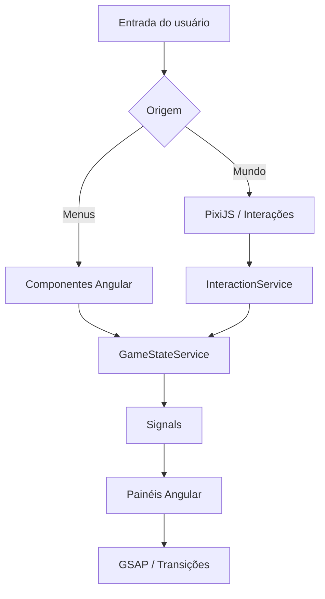

# Arquitetura — Portfólio RPG com Angular

> Portfólio híbrido inspirado na experiência de MMORPGs clássicos, especialmente Old School RuneScape (OSRS), com identidade visual própria.

## 1. Visão geral

Criar uma SPA em Angular que combine um cenário 2D explorável com uma interface de RPG clássico. O visitante pode interagir com personagens e objetos do cenário ou acessar diretamente painéis que apresentam o perfil profissional, habilidades, projetos e formas de contato.

**Objetivos de experiência:**
- Apresentar conteúdo profissional sem obrigar o visitante a jogar.
- Manter a estética retrô com navegação acessível, responsiva e rápida.
- Permitir explorar um pequeno mundo, abrir menus e interagir com NPCs.
- Evitar copiar sprites, músicas, marcas ou interfaces proprietárias do OSRS; criar assets próprios ou devidamente licenciados.

## 2. Stack

| Tecnologia | Papel |
| --- | --- |
| Angular + TypeScript | SPA, componentes, roteamento e injeção de dependências |
| Angular Signals | Estado reativo da interface e progresso local |
| PixiJS | Renderização 2D do cenário, sprites e câmera |
| GSAP | Animações de janelas, transições, tooltips e feedback visual |
| SCSS | Design system retrô, temas e layout responsivo |
| Angular CDK (opcional) | Overlays, foco e acessibilidade de painéis |
| Howler.js (opcional) | Efeitos sonoros e áudio ambiente |

**Princípio:** PixiJS gerencia o mundo; Angular gerencia menus e conteúdo; GSAP anima a interface. O movimento contínuo do personagem deve ser atualizado pelo loop da engine, não por timelines GSAP.

## 3. Layout

```text
+---------------------------------------------------------------+
| TOP BAR: Personagem | Level | GitHub | LinkedIn | Config      |
+-------------------------------------------+-------------------+
|                                           | GAME PANEL        |
| GAME WORLD (PixiJS)                       |                   |
| - Mapa / cenário                          | Skills            |
| - Personagem                              | Inventory         |
| - NPCs / objetos interativos              | Quest Log         |
| - Interações                              | Character         |
|                                           |                   |
+-------------------------------------------+-------------------+
| ACTION BAR: diálogo | dicas | atalhos | áudio                 |
+---------------------------------------------------------------+
```

Em telas pequenas, o cenário ocupa a área principal e os painéis aparecem como drawers ou modais; a navegação direta permanece sempre disponível.

## 4. Mapeamento de conteúdo

| Conteúdo profissional | Representação RPG |
| --- | --- |
| Sobre mim | Character Profile |
| Tecnologias e competências | Skills |
| Projetos | Quest Log |
| Experiência profissional | Adventure Log |
| Ferramentas e stack | Inventory |
| Contato | NPC Dialogue |

### Exemplos de interação

- **Skills:** grade de habilidades com ícones, nível simbólico e descrição real da experiência.
- **Quests:** projetos com estado (concluído/em andamento), desafios, stack, resultados e links.
- **Inventory:** tecnologias e ferramentas organizadas em slots clicáveis.
- **NPC Dialogue:** conversas curtas que levam a seções do portfólio.
- **Character Profile:** apresentação, especialidades, currículo e redes profissionais.

## 5. Arquitetura de componentes

```text
src/
├── app/
│   ├── core/
│   │   ├── models/
│   │   │   ├── player.model.ts
│   │   │   ├── skill.model.ts
│   │   │   ├── quest.model.ts
│   │   │   └── interaction.model.ts
│   │   └── services/
│   │       ├── game-state.service.ts
│   │       ├── interaction.service.ts
│   │       └── audio.service.ts
│   ├── game/
│   │   ├── engine/
│   │   │   ├── game-engine.ts
│   │   │   ├── player-controller.ts
│   │   │   ├── camera-controller.ts
│   │   │   └── collision-system.ts
│   │   ├── scenes/
│   │   │   └── village.scene.ts
│   │   └── components/
│   │       └── game-canvas/
│   ├── features/
│   │   ├── character/
│   │   ├── skills/
│   │   ├── inventory/
│   │   ├── quests/
│   │   ├── dialogue/
│   │   └── settings/
│   ├── shared/
│   │   ├── components/
│   │   │   ├── game-window/
│   │   │   ├── game-tooltip/
│   │   │   └── game-button/
│   │   └── animations/
│   │       └── gsap-animations.ts
│   ├── layout/
│   │   └── game-shell/
│   └── app.routes.ts
└── assets/
    ├── sprites/
    ├── maps/
    ├── icons/
    ├── audio/
    └── fonts/
```

### Responsabilidades

- **GameShellComponent:** organiza mundo, HUD e painéis.
- **GameCanvasComponent:** inicializa e destrói o PixiJS no ciclo de vida do Angular.
- **GameEngine:** coordena ticker, cena e recursos gráficos.
- **PlayerController:** entrada de teclado/toque, movimento e colisões.
- **InteractionService:** traduz interações com NPCs e objetos em ações de UI.
- **GameStateService:** Signals para painel ativo, diálogo, preferências e progresso local.
- **GameWindowComponent:** janela reutilizável com cabeçalho, conteúdo e botão fechar.
- **SkillsPanelComponent:** lista e detalha habilidades.
- **InventoryPanelComponent:** exibe tecnologias em slots.
- **QuestLogComponent:** lista projetos e abre seus detalhes.
- **DialogueComponent:** mostra falas e opções de navegação.

## 6. Fluxo de dados



**Regra de acoplamento:** a engine emite eventos sem manipular diretamente componentes Angular. Os serviços traduzem os eventos para estado observável por Signals.

## 7. Estado sugerido

```ts
type PanelId = 'character' | 'skills' | 'inventory' | 'quests' | 'settings';

interface PortfolioState {
  activePanel: PanelId | null;
  activeNpcId: string | null;
  soundEnabled: boolean;
  reducedMotion: boolean;
}
```

Dados de projetos, habilidades e itens podem começar em arquivos TypeScript/JSON locais, tipados por interfaces. Não é necessário backend no MVP.

## 8. Estratégia de animação

**PixiJS:** movimento do personagem, câmera, cenário, animação de sprites e indicadores de interação.

**GSAP:** entrada e saída de painéis, alternância de abas, notificações, efeitos de hover e sequências de apresentação.

**Angular:** componentes e estado; usar `afterNextRender` quando a animação depender do DOM e limpar animações ao destruir componentes, por exemplo com `gsap.context().revert()`.

Respeitar `prefers-reduced-motion`; não usar animações como único indicador de estado.

## 9. Acessibilidade e performance

- Menus navegáveis por teclado, com rótulos e foco visível.
- Alternativa direta ao cenário para acessar todo o conteúdo.
- Contraste adequado, texto legível e áudio desligado por padrão.
- Carregar assets do cenário sob demanda; manter spritesheets otimizadas.
- Pausar ou reduzir atualizações da engine quando a aba estiver oculta.
- Destruir ticker, listeners, texturas próprias e instâncias PixiJS ao desmontar o canvas.
- Testar uso por toque e layouts móveis desde o início.
- Priorizar conteúdo indexável em HTML Angular; não deixar textos essenciais apenas no canvas.

## 10. Roadmap

### Fase 1 — MVP navegável

- [ ] Criar projeto Angular com SCSS.
- [ ] Definir paleta, tipografia e componentes básicos.
- [ ] Implementar GameShell e HUD responsivos.
- [ ] Criar painéis Character, Skills, Inventory e Quests.
- [ ] Alimentar os painéis com conteúdo real.
- [ ] Adicionar transições GSAP e navegação por teclado.

### Fase 2 — Mundo interativo

- [ ] Integrar PixiJS ao GameCanvasComponent.
- [ ] Criar mapa pequeno e personagem com sprites originais/licenciados.
- [ ] Implementar movimentação, câmera e limites do mapa.
- [ ] Adicionar NPCs e hotspots que abrem painéis.
- [ ] Sincronizar eventos do mundo com Angular Signals.

### Fase 3 — Polimento

- [ ] Adicionar diálogos, sons opcionais e feedback visual.
- [ ] Refinar responsividade e acessibilidade.
- [ ] Otimizar carregamento, renderização e limpeza de recursos.
- [ ] Publicar e testar com visitantes reais.

## 11. Decisões recomendadas

1. **Começar pelos painéis Angular:** o portfólio já será útil antes de existir um mundo explorável.
2. **Construir apenas uma cena pequena no MVP:** evita transformar o portfólio em um projeto de game completo.
3. **Usar Signals como fonte da verdade da UI:** não duplicar estado entre engine e componentes.
4. **Manter o mundo opcional:** visitantes podem ir diretamente para projetos, currículo e contato.
5. **Criar identidade visual original:** inspiração em OSRS sem reproduzir assets protegidos.

## 12. Comandos iniciais

```bash
npx @angular/cli@latest new portfolio-rpg --style=scss --routing
cd portfolio-rpg
npm install gsap pixi.js
# Opcionais:
npm install howler
npm install @angular/cdk
```

**Resultado esperado:** um portfólio funcional, acessível e responsivo que se apresenta como um RPG clássico, com uma interface Angular independente e um mundo 2D progressivamente enriquecido.
