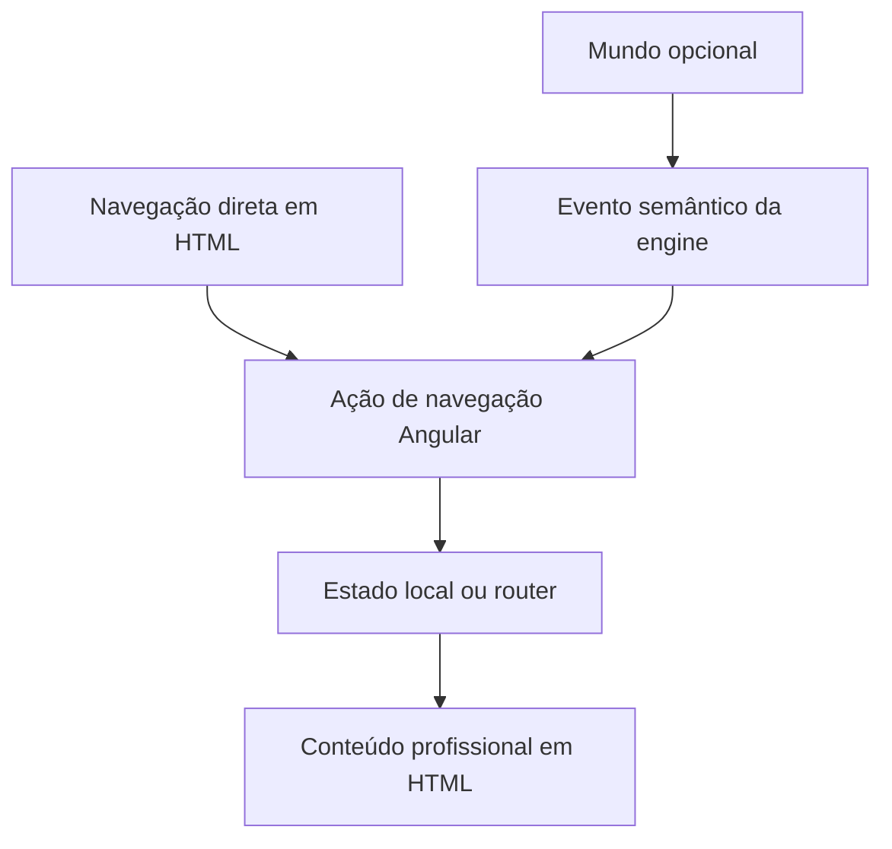

# Arquitetura — Portfólio RPG com Angular

> Proposta de evolução do portfólio existente, inspirada em MMORPGs clássicos como Old School RuneScape, com identidade própria. O mundo e os painéis descritos abaixo ainda não estão implementados.

## 1. Estado atual e referências

O workspace Nx contém uma única aplicação, `portfolio`, em `src/`. O bootstrap standalone está em `src/main.ts`; `src/app/app.ts` usa `app.html` e `app.scss` e renderiza `NxWelcome`. As rotas em `app.routes.ts` estão vazias. O scaffold não é conteúdo profissional aprovado.

Após a atualização de 29/10/2026, o lockfile resolve Angular 22.2.4, CLI e build 22.2.5, Nx 24.0.2, TypeScript 6.0.3 e RxJS 7.8.2. Confirme sempre [package.json](../package.json), [package-lock.json](../package-lock.json), [project.json](../project.json) e [nx.json](../nx.json): números em referências e skills podem ficar desatualizados.

A base usa SCSS e renderização no cliente. Não há engine 2D, GSAP, Howler.js, CDK, Angular Material, Angular Aria, framework CSS, biblioteca de ícones, backend, cliente HTTP configurado, SSR, prerender ou hidratação. Não há alvo de testes automatizados ou configuração E2E; o script `npm test` não representa uma suíte funcional.

Seguir [AGENTS.md](../AGENTS.md) e consultar as skills pertinentes antes de implementar:

| Skill                                                                                            | Responsabilidade                                                     |
| ------------------------------------------------------------------------------------------------ | -------------------------------------------------------------------- |
| [angular-developer](../.agent/skills/angular-developer/SKILL.md)                                 | Componentes, estado, rotas e APIs compatíveis com a versão instalada |
| [angular-cdk](../.agent/skills/angular-cdk/SKILL.md)                                             | Avaliar overlays e foco quando HTML nativo não atender               |
| [design-md](../.agent/skills/design-md/SKILL.md)                                                 | Separar identidade implementada de proposta visual                   |
| [portfolio-performance](../.agent/skills/portfolio-performance/SKILL.md)                         | Budgets, carregamento e medições reproduzíveis                       |
| [portfolio-integrations](../.agent/skills/portfolio-integrations/SKILL.md)                       | Conteúdo confirmado, contratos e contato real                        |
| [context-engineering](../.agent/skills/context-engineering/SKILL.md)                             | Distinguir implementação, proposta e decisões pendentes              |
| [debugging-and-error-recovery](../.agent/skills/debugging-and-error-recovery/SKILL.md)           | Diagnosticar falhas preservando alterações locais                    |
| [observability-and-instrumentation](../.agent/skills/observability-and-instrumentation/SKILL.md) | Diagnóstico local, dados mínimos e descarte de recursos              |

## 2. Objetivo e conteúdo

Evoluir a SPA existente para combinar conteúdo profissional em HTML com um cenário 2D opcional. O visitante deve acessar apresentação, projetos, competências e contato diretamente, sem mover personagem, concluir missões ou habilitar áudio.

Usar português nos textos ao visitante e inglês nos nomes de código. Publicar somente fatos, experiências, resultados e links confirmados no repositório ou fornecidos pelo usuário. A metáfora RPG não autoriza inventar qualificações, clientes, métricas ou níveis de domínio.

| Seção em português | Metáfora RPG opcional  | Conteúdo permitido                                       |
| ------------------ | ---------------------- | -------------------------------------------------------- |
| Sobre mim          | Ficha do personagem    | Apresentação e especialidades confirmadas                |
| Competências       | Habilidades            | Descrições reais, sem notas de proficiência inventadas   |
| Projetos           | Diário de missões      | Estado, desafios, stack, resultados e links verificáveis |
| Experiência        | Diário de aventuras    | Experiências documentadas ou fornecidas                  |
| Ferramentas        | Inventário             | Tecnologias efetivamente utilizadas                      |
| Contato            | Diálogo com personagem | Canais confirmados, também disponíveis fora do cenário   |

Rótulos claros acompanham as metáforas. Currículo, redes e informações profissionais dependem de conteúdo confirmado; não criar destinos fictícios. Assets devem ser próprios ou licenciados, com origem e licença registradas. Não reproduzir sprites, músicas, marcas ou interfaces proprietárias do OSRS.

## 3. Stack e dependências

| Recurso                  | Decisão                                                                                                       |
| ------------------------ | ------------------------------------------------------------------------------------------------------------- |
| Angular, TypeScript e Nx | Base instalada; reutilizar bootstrap, componentes, router e injeção de dependências                           |
| Signals e `computed`     | Estado local e derivado quando houver interação; conteúdo estático não exige serviço                          |
| SCSS e CSS               | Base visual; preferir CSS para transições simples                                                             |
| PixiJS                   | Candidato para a exploração futura; avaliar necessidade, compatibilidade, bundle e descarte antes de instalar |
| GSAP                     | Candidato somente para sequências que CSS não resolva adequadamente                                           |
| Angular CDK              | Candidato para foco ou overlays complexos; não implica instalar Material                                      |
| Howler.js                | Candidato se o áudio justificar a dependência; considerar APIs nativas para casos simples                     |

Nenhuma biblioteca candidata está instalada ou é pré-requisito do MVP. Referências genéricas não autorizam instalações. Conferir a documentação oficial da versão escolhida no momento da implementação.

Se adotada, a engine gerencia cena, câmera, colisões e atualização contínua; Angular gerencia conteúdo e navegação. Movimento por frame não depende de timelines de animação de interface nem deve propagar coordenadas continuamente para Signals.

## 4. Layout e identidade

No desktop, a proposta combina cabeçalho com navegação direta, exploração opcional e painéis de conteúdo. No mobile, priorizar leitura e navegação; o visitante pode ativar o cenário. Som e movimento devem ter controles acessíveis fora do mundo.

Definir paleta, tipografia, contraste, espaçamento e estados a partir de referências aprovadas e registrar as decisões em um futuro `DESIGN.md`. O visual de `NxWelcome` é scaffold, não identidade final. Usar SCSS local e `src/styles.scss` para regras globais; não importar sistemas visuais de outros produtos.

## 5. Organização incremental

Manter os arquivos existentes. Criar diretórios somente quando responsabilidade ou reutilização justificar, sem gerar outra aplicação ou bibliotecas compartilhadas antecipadamente.

```text
src/
├── main.ts
├── styles.scss
└── app/
    ├── app.ts / app.html / app.scss
    ├── app.config.ts
    ├── app.routes.ts
    ├── features/                 # Proposta: conteúdo profissional
    │   ├── profile/
    │   ├── skills/
    │   ├── projects/
    │   └── contact/
    ├── game/                     # Proposta posterior: exploração opcional
    │   ├── game-canvas/
    │   ├── engine/
    │   └── scenes/
    └── shared/                   # Somente com reutilização concreta
        └── game-window/
public/                           # Diretório de assets configurado
├── favicon.ico                   # Existente
├── sprites/                      # Propostos
├── maps/
├── audio/
└── fonts/
```

Seguir nomes como `profile.ts`, `profile.html` e `profile.scss`, preservando o padrão de `app.ts`. Dados locais tipados podem ficar junto da funcionalidade. Não criar automaticamente camadas `core/models/services`, fachadas ou estado global para conteúdo estático.

O build copia `public/` para a raiz da saída. Se criado, `public/sprites/player.png` será referenciado como `sprites/player.png`, considerando o base URL do deploy. Não usar `src/assets` sem alterar deliberadamente a configuração.

Responsabilidades propostas:

- O shell organiza navegação, conteúdo e exploração.
- Componentes de seção apresentam dados profissionais em HTML semântico.
- `GameCanvas` inicializa a engine após a renderização do host e a descarta ao sair. Falha de inicialização mantém o conteúdo acessível.
- `GameEngine` coordena recursos e loop sem manipular componentes Angular.
- `PlayerController` trata entrada e limites do mundo sem capturar teclas quando o foco estiver em campos ou controles.
- Extrair serviço de interação somente quando múltiplos consumidores precisarem traduzir eventos da engine em navegação.
- Extrair janela compartilhada somente quando existir um padrão real de painéis e foco.

## 6. Navegação e estado

Começar com navegação semântica entre seções. Adicionar rotas e carregamento lazy quando houver páginas ou custo que os justifique. Quando houver rotas, manter endereço, histórico e botão Voltar coerentes; o mesmo conteúdo deve abrir por menu e pelo mundo.



Signals representam somente estado de interface reativo. Se a rota já identifica a seção aberta, não duplicar essa fonte de verdade. Coordenadas e animação contínua ficam na engine.

Exemplo de estado possível, ainda não implementado:

```ts
type PanelId = 'profile' | 'skills' | 'projects' | 'contact' | 'settings';

interface PortfolioState {
  activePanel: PanelId | null;
  activeNpcId: string | null;
  soundEnabled: boolean;
}
```

Som começa desabilitado. Movimento reduzido acompanha `prefers-reduced-motion`; preferências adicionais devem ter semântica clara. Persistência local é opcional, limitada a preferências não sensíveis, tolerante a armazenamento indisponível e desnecessária para ler o portfólio. O MVP não exige conta, backend ou banco de dados.

## 7. Acessibilidade e animação

- Usar títulos, landmarks, links e botões nativos; texto essencial fica em HTML, fora do canvas.
- Garantir teclado, foco visível e nomes acessíveis. Todo hotspot precisa de alternativa direta em HTML.
- Modais exigem foco inicial, contenção, Escape e retorno ao acionador; painéis não modais não prendem o foco. Avaliar controles nativos antes de CDK.
- Suportar toque sem depender de hover, arraste ou atalhos como único meio de operação.
- Respeitar movimento reduzido, permitir pausar exploração e não usar animação como único indicador de estado.
- Ativar áudio somente por ação do visitante, com volume e opção de desligar.

Preferir CSS para efeitos simples. Animações dependentes do DOM usam o ciclo de renderização Angular apropriado, com limpeza na destruição. Se GSAP for justificado, descartar contextos e timelines.

A migração para Angular 22 preservou o comportamento anterior com `ChangeDetectionStrategy.Eager` nos componentes existentes. Alterações futuras dessa estratégia exigem avaliação própria; a atualização de dependências não equivale à adoção automática de novos padrões.

## 8. Performance e resiliência

O conteúdo deve funcionar antes do download da engine. Carregar mundo, áudio e assets pesados sob demanda. Dividir código quando houver benefício medido, sem fragmentar excessivamente a página.

| Budget em `project.json` | Aviso  | Erro |
| ------------------------ | ------ | ---- |
| Bundle inicial           | 500 kB | 1 MB |
| Estilo por componente    | 4 kB   | 8 kB |

Não aumentar limites para esconder regressões. Otimizar spritesheets, imagens e fontes e reservar dimensões para evitar deslocamento de layout. Pausar ticker em aba oculta ou com exploração desativada. Descartar listeners, observers, timers, assinaturas, instâncias e texturas pertencentes à cena ao desmontá-la.

Comparar carregamento, interação e memória com viewport, rede e cache equivalentes. Não há Lighthouse ou métricas de produção configurados. HTML renderizado no cliente não equivale a SSR ou garantia de indexação; avaliar prerender ou SSR somente quando o requisito de descoberta justificar.

## 9. Integrações e diagnóstico

Começar com conteúdo local tipado. Contato usa links confirmados; `mailto` somente com endereço fornecido. Formulário de envio depende de serviço e contrato reais, com carregamento, erro, repetição e sucesso conforme a resposta. Sem contrato, não inventar endpoints nem mostrar sucesso fictício.

Não incluir segredos no bundle ou em `public/`. Começar o diagnóstico por console, rede e Performance do navegador. Atualmente existem `provideBrowserGlobalErrorListeners()` e registro de falha de bootstrap no console; não há coletor remoto, analytics ou tracing configurados. Não registrar dados pessoais, tokens ou corpos de formulário.

Em bancos, somente `SELECT` é permitido. Não executar procedures, escritas, migrações de banco ou seeds. Validações locais não devem enviar contato real nem alterar dados externos.

## 10. Roadmap e critérios de aceite

### Fase 1 — Conteúdo profissional em HTML

- [x] Reutilizar o workspace Angular/Nx existente com SCSS.
- [ ] Confirmar apresentação, competências, projetos e canais de contato.
- [ ] Definir identidade própria e registrar tokens e estados aprovados.
- [ ] Substituir `NxWelcome` por seções responsivas.
- [ ] Implementar navegação direta, teclado, foco e movimento reduzido.
- [ ] Validar lint, build e fluxos manualmente no desktop e mobile.

Aceite: conteúdo completo acessível sem cenário, som ou mecânicas de jogo; informações e links confirmados. Esta fase não exige engine ou biblioteca de animação.

### Fase 2 — Exploração opcional

- [ ] Avaliar engine e registrar necessidade, compatibilidade e impacto de bundle antes de instalar.
- [ ] Criar uma cena pequena com assets próprios ou licenciados.
- [ ] Implementar movimento, câmera, limites e interações equivalentes à navegação direta.
- [ ] Manter conteúdo disponível em falhas de assets ou renderização.
- [ ] Verificar pausa, descarte, teclado e toque.

Aceite: explorar é opcional, nenhum conteúdo depende da engine e seu carregamento não bloqueia a leitura inicial.

### Fase 3 — Polimento e publicação

- [ ] Adicionar diálogos e áudio opcional quando agregarem valor.
- [ ] Medir e otimizar carregamento, estabilidade visual e memória.
- [ ] Revisar contraste, foco, mobile e movimento reduzido.
- [ ] Definir hospedagem e validar URLs e fallback SPA no ambiente escolhido.

Aceite: cumprir budgets e critérios de acesso ao conteúdo, com limitações registradas. Hospedagem, domínio e deploy ainda não estão definidos.

## 11. Comandos e validação

Executar na raiz deste repositório, sem `ng new` ou criação de outra aplicação:

```bash
npm ci
npx nx show project portfolio
npx nx serve portfolio
npx nx lint portfolio
npx nx build portfolio
npx nx build portfolio --configuration=development
npx nx run portfolio:serve-static
```

`npm start` e `npm run build` também estão disponíveis. O lint é inferido por `@nx/eslint/plugin` e executa `eslint ./src`, com inputs complementares em `project.json`. A saída é `dist/portfolio`; o servidor estático serve `dist/portfolio/browser` com fallback SPA.

Código exige lint e build dos alvos afetados. Interface exige inspeção manual de leitura, navegação, teclado, foco, mobile, movimento reduzido, links e console. Quando houver mundo, incluir falha de assets, saída e reentrada na cena, pausa e descarte. Infraestrutura de testes é uma decisão separada quando solicitada ou justificada; não relatar testes automatizados como aprovados sem runner e alvo funcionais.

Documentação exige conferir links locais, formatação e `git diff --check`. Registrar resultados e verificações não executadas; proposta e histórico não equivalem a validação atual.

### Verificações da atualização em 29/10/2026

- Migrações oficiais de Angular e Nx aplicadas e lockfile atualizado.
- Grafo consultado com daemon e cache de grafo desabilitados; lint inferido preserva `eslint ./src`.
- Lint e builds de produção e desenvolvimento aprovados sem cache de tarefas.
- O estilo do scaffold `NxWelcome` tem 7,03 kB: acima do aviso de 4 kB, abaixo do erro de 8 kB. Budgets preservados.
- `npm audit` reportou 8 ocorrências na cadeia de ferramentas de desenvolvimento associadas a `undici` utilizado pelo Nx: 7 moderadas e 1 alta. Não foi aplicado downgrade ou correção forçada dessa cadeia.
- Não houve teste automatizado, por ausência de alvo configurado, nem inspeção visual em navegador nesta atualização.
